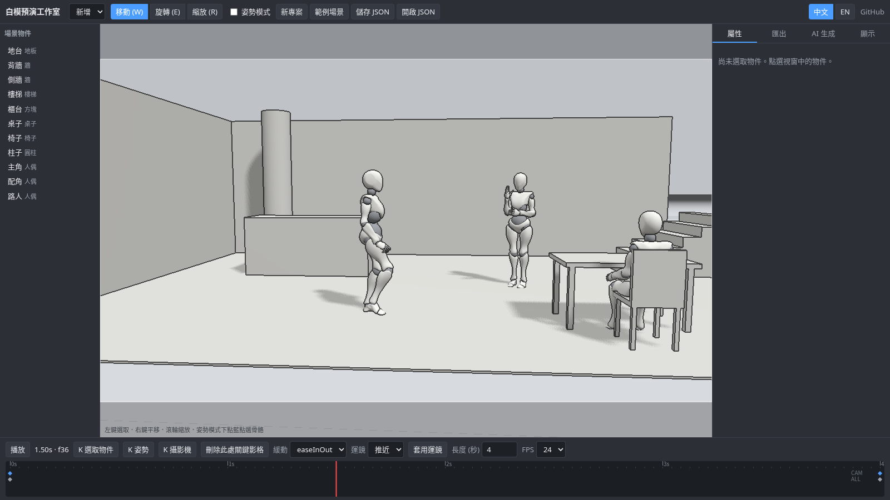
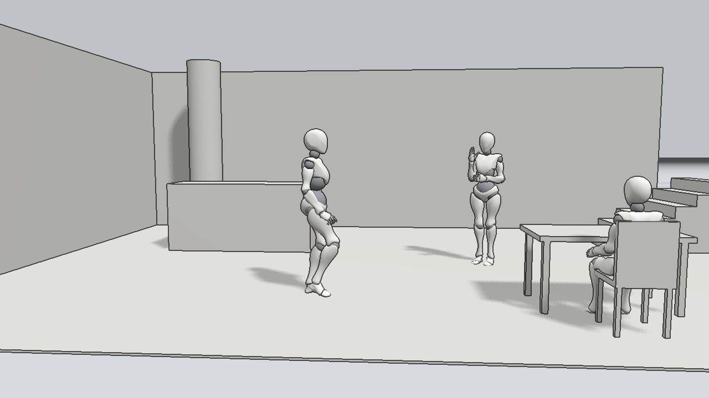
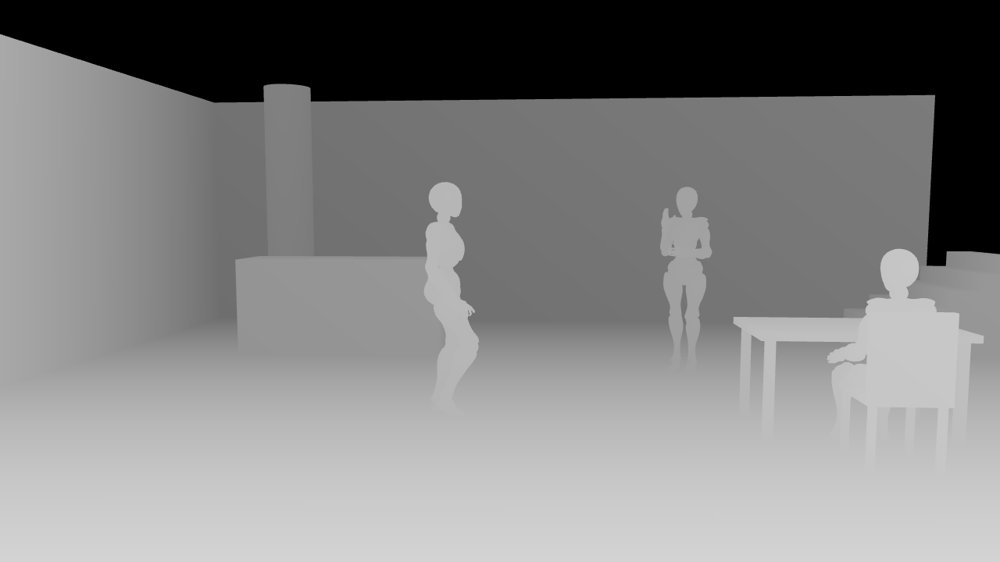
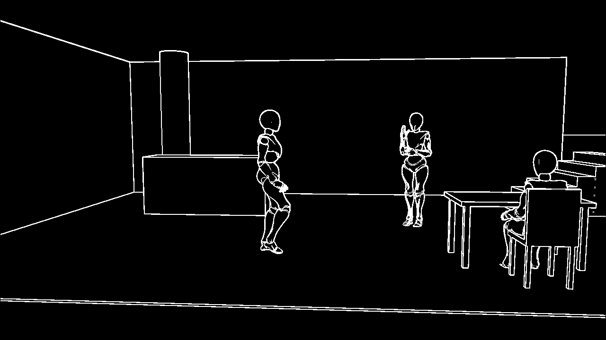
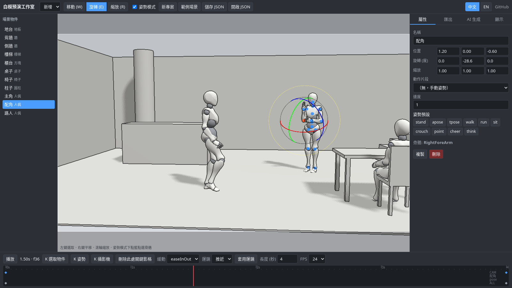
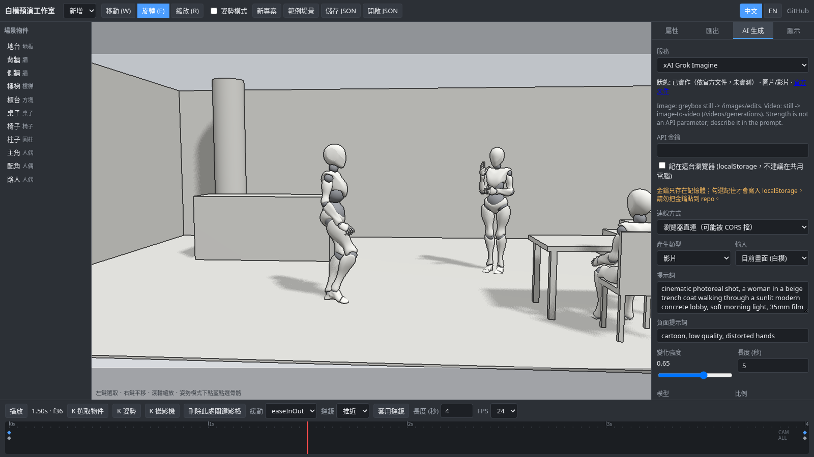

# Greybox Previs Studio · 白模預演工作室

用 **three.js** 在瀏覽器裡搭白模場景、擺人偶姿勢、打關鍵影格運鏡，匯出靜態圖、ControlNet 用的深度/法線/邊緣圖、序列圖和影片，再把這些素材送到圖片/影片生成模型（xAI Grok Imagine、Runway、Luma、Kling、Replicate、fal.ai），變成寫實影片。

**線上試用：** https://stevenke1981.github.io/greybox-previs-studio/



| 白模 (beauty) | 深度 (depth) | 邊緣 (edge) |
|---|---|---|
|  |  |  |

| 姿勢模式 Pose mode | AI 生成面板 AI panel |
|---|---|
|  |  |

[English below](#english)

## 功能

- **場景**：灰白黏土材質的骨架人偶（three.js 範例的 Xbot，Mixamo 骨架），方塊、圓柱、球、圓錐、地板、牆、樓梯、桌、椅；格線地面、柔和光源與陰影；螢幕空間輪廓線，另有可選的環境光遮蔽 (GTAO)。
- **擺姿勢**：開「姿勢模式」後點人偶身上的藍點選骨骼，用旋轉把手調整。內建 10 種姿勢預設（站、A/T pose、走、跑、坐、蹲、指、歡呼、思考），也能播放模型內建的 idle / walk / run 等動作片段，速度可調。
- **時間軸**：物件位置/旋轉/縮放、骨骼旋轉、攝影機（位置/目標/FOV）都能打關鍵影格，可拖曳時間軸預覽、播放，有 5 種緩動。運鏡預設：推近、橫移、環繞、升降、固定。
- **專案**：存成 JSON、讀回 JSON（有格式驗證）。
- **匯出**
  - PNG 靜態圖：自訂解析度（最大 4096），可透明背景。
  - 深度圖、法線圖、類 Canny 邊緣圖，可直接當 ControlNet 的引導圖。
  - 序列圖 ZIP（可多個通道同時輸出，附 ffmpeg 指令）。
  - 影片：**WebM (VP9)**，瀏覽器支援 H.264 時也能輸出 **MP4**。用 WebCodecs 逐格算圖，時間戳固定，所以輸出跟電腦快慢無關。沒有 WebCodecs 的瀏覽器會改用 MediaRecorder 即時錄製。不需要 ffmpeg.wasm。
- **AI 生成**：選服務、輸入提示詞與強度，把目前畫面（白模/深度/邊緣）、最後匯出的影片或網址送出，之後自動輪詢，完成後在面板中預覽、下載。

## 快速開始

```bash
npm i
npm run dev          # http://localhost:5173
npm test             # vitest
npm run build        # 型別檢查 + 打包到 dist/
```

操作：左鍵選取、右鍵平移、滾輪縮放；W/E/R 切換移動/旋轉/縮放，空白鍵播放，K 對選取物件打關鍵影格，Delete 刪除。視窗中的白框就是匯出畫面的範圍。

## AI 服務設定

| 服務 | 狀態 | 支援 | 輸入 | 文件 |
|---|---|---|---|---|
| xAI Grok Imagine | 已實作 | 圖片（generations / edits）、影片（image-to-video） | data URL 或網址 | [Images](https://docs.x.ai/developers/rest-api-reference/inference/images) · [Videos](https://docs.x.ai/developers/rest-api-reference/inference/videos) |
| Replicate | 已實作（通用） | 任何模型：`owner/name` 或版本 hash | data URL 或網址 | [HTTP API](https://replicate.com/docs/reference/http) |
| fal.ai | 已實作（通用，queue API） | 任何模型 ID | data URL 或網址 | [Queue](https://docs.fal.ai/model-apis/model-endpoints/queue) |
| Runway | 已實作 | Gen-4 image_to_video、gen4_aleph video_to_video | data URL 或網址 | [API](https://docs.dev.runwayml.com/api/) |
| Luma Dream Machine | 已實作 | Ray 2 影片、Photon 圖片 | **只接受公開網址** | [Video](https://docs.lumalabs.ai/docs/video-generation) |
| Kling AI | 已實作 | image2video（v1 task API）、API key 或 AK/SK JWT | data URL（自動轉 base64）或網址 | [Kling API](https://app.klingai.com/global/dev/document-api) |

> 這些 adapter 都是照官方文件寫的，用模擬回應做了單元測試，**還沒有用真的 API 金鑰實際呼叫過**。各家模型參數變動很快，可以用「額外 JSON 參數」補欄位或覆寫預設值（Replicate/fal 可用 `"$image"`、`"$video"` 代表輸入素材）。

**金鑰安全**：金鑰預設只放在記憶體；勾選「記住」才會存進 localStorage（共用電腦不要勾）。repo 的 `.gitignore` 已排除 `.env`。

### CORS 與本機 Proxy

多數服務不允許瀏覽器直接呼叫，會被 CORS 擋下。這時改用附的零依賴 Node proxy，金鑰放在伺服器端的 `.env`，不會進到瀏覽器：

```bash
cp .env.example .env    # 填入要用的金鑰
npm run proxy           # http://127.0.0.1:8787
```

然後在 AI 面板把「連線方式」切成「本機 Proxy」。Proxy 只轉送到各服務白名單內的主機，並只允許 `PROXY_ALLOWED_ORIGINS` 列出的網頁來源。線上 demo (GitHub Pages) 也能連你本機的 proxy。

## 專案結構

```
src/studio.ts        three.js 場景、人偶、選取、時間軸套用、匯出算圖
src/timeline.ts      純函式關鍵影格/緩動/slerp（有單元測試）
src/shots.ts         運鏡預設      src/poses.ts   姿勢預設（以世界方向描述，跟骨架軸向無關）
src/exporters.ts     PNG / ZIP / WebM / MP4      src/edges.ts   邊緣圖
src/edgePass.ts      螢幕空間輪廓線
src/providers/       各家 AI adapter + 共用 runner（送出 → 輪詢 → 取得結果）
server/proxy.mjs     選用的 CORS proxy
scripts/verify.mjs   Playwright 無頭瀏覽器驗證（算圖、匯出檔案）
```

## 限制

- 人偶模型只有一種體型（Xbot），還沒有手指骨骼控制、IK 和關節角度限制。
- 姿勢模式中，有套用動作片段的人偶會先切回手動姿勢。
- Luma 只接受公開圖片網址，需要先把匯出的圖上傳到別處。
- AI adapter 尚未用真實金鑰測試。

## 授權

MIT © 2026 Ke Sheng Da。`public/models/Xbot.glb` 取自 three.js（MIT），原始角色由 Adobe Mixamo 製作，詳見 [public/models/README.md](public/models/README.md)。

---

## English

**Greybox Previs Studio** is a browser previs tool built with three.js. Block out a scene with clay-grey mannequins and primitives, pose them, keyframe objects/bones/camera, export stills, ControlNet-style guidance passes, image sequences and video, then send them to image/video generation models to get photoreal footage.

**Live demo:** https://stevenke1981.github.io/greybox-previs-studio/

### Features
- Rigged clay mannequins (three.js Xbot, Mixamo skeleton), primitives (box, cylinder, sphere, cone, floor, wall, stairs, table, chair), grid, soft lights and shadows, screen-space ink outline, optional GTAO.
- Pose mode: click the blue joint dots and rotate bones with the gizmo; 10 pose presets; built-in clips (idle/walk/run/…) driven by timeline time.
- Keyframe timeline for object transforms, bone rotations and camera position/target/FOV with scrub/play and 5 easings; camera shot presets (push-in, dolly, orbit, crane, static).
- Save/load project JSON (validated).
- Export: PNG (custom size, optional transparent background), depth / normal / Canny-like edge passes, PNG sequence ZIP, **deterministic** WebM (VP9) and MP4 (H.264 when supported) via WebCodecs with fixed per-frame timestamps; MediaRecorder fallback. No ffmpeg.wasm needed.
- AI panel with a provider adapter interface: xAI Grok Imagine (image + video), Replicate (generic), fal.ai (generic queue), Runway Gen-4 (image→video, video→video), Luma Dream Machine (Ray 2 / Photon), Kling (image2video). Submit → poll → preview/download.

### Quickstart
```bash
npm i && npm run dev
```
`npm test` runs vitest (timeline interpolation, project JSON round-trip, edge map, provider request builders with mocked `fetch`, proxy routing). `node scripts/verify.mjs` (after `npm run build && npx vite preview --port 4173`) renders the scene in headless Chromium and writes sample exports.

### Providers & keys
All adapters follow the public docs linked in the table above and are covered by mocked tests, but **none has been exercised against a live API yet**. Keys live in memory unless you tick “Remember” (localStorage). Because most APIs block browser CORS, run the bundled zero-dependency proxy (`cp .env.example .env && npm run proxy`) and switch the connection to “Local proxy”; keys then stay server-side. The proxy only forwards to each provider's allow-listed hosts and only accepts the origins in `PROXY_ALLOWED_ORIGINS`.

### Limitations
Single mannequin body type, no finger/IK/joint limits; Luma requires public image URLs; adapters are untested with real keys.

### License
MIT © 2026 Ke Sheng Da. `Xbot.glb` comes from the three.js repo (MIT); the character was originally made with Adobe Mixamo.
